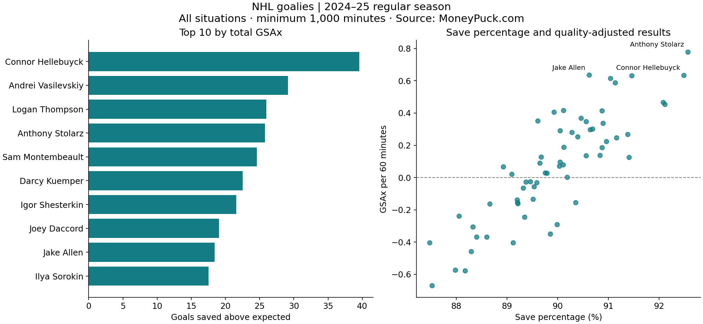

# NHL Goalie Performance Analysis

A reproducible Python EDA comparing traditional save percentage with goals saved above expected (GSAx), using MoneyPuck's 2024–25 regular-season goalie data.

## Key findings

Among **62 goalies with at least 1,000 minutes**, across all situations:

- **Connor Hellebuyck** leads total GSAx at **39.59 goals**.
- **Anthony Stolarz** leads GSAx per 60 minutes at **0.778**.
- Save percentage and GSAx per 60 have a Pearson correlation of **0.855**. They share a goals-allowed component, so this association is partly mathematical and is not independent validation of either metric.

Total and rate leaders differ: workload matters when comparing season contributions with performance per unit of playing time.



## Run

Python 3.10 or later:

```bash
python -m venv .venv
# macOS/Linux:
source .venv/bin/activate
# Windows PowerShell instead: .venv\Scripts\Activate.ps1
python -m pip install -r requirements.txt
python analyze.py
```

The bundled CSV makes the analysis runnable offline after dependencies are installed. The optional `analysis.ipynb` notebook requires Jupyter. Run notebook cells in order. Output files are regenerated in `results/`.

## Definitions and scope

| Metric | Calculation | Interpretation |
| --- | --- | --- |
| GSAx | xGoals − goals | Positive means fewer goals allowed than the model expected |
| GSAx per 60 | GSAx × 3600 / icetime | Quality-adjusted result normalized by time |
| Save percentage | 1 − goals / ongoal | Fraction of shots on goal saved |
| GAA | goals × 3600 / icetime | Goals allowed per 60 minutes |

`icetime` is in seconds. The season code `2024` means 2024–25. Select only `situation = all`; summing that row with situation-specific rows would double-count. The downloaded data contains one all-situations row per goalie ID; the script rejects duplicate IDs. It retains positive-time, positive-shot records, then applies the 1,000-minute cutoff. No team split rows are added together.

This is descriptive season-level analysis, not a forecast or a causal estimate of goalie talent. GSAx depends on MoneyPuck's expected-goal model and does not eliminate every team or defensive effect. Rates can be unstable with limited playing time. `threshold_sensitivity.csv` repeats the rate-leader comparison at 500, 1,000, 1,500 and 2,000 minutes to show how eligibility changes the result. No confidence intervals are estimated from aggregate season data.

## One-hour walkthrough

| Minutes | Activity |
| --- | --- |
| 0–10 | Inspect source columns, situation rows, units and duplicate goalie IDs |
| 10–25 | Filter the season and calculate GSAx, rates and save percentage |
| 25–40 | Compare total/rate rankings and inspect the chart |
| 40–50 | Explore the eligibility-threshold sensitivity output |
| 50–60 | Explain the two leaders, metric limitations and a follow-up question |

Follow-up: use game-level data and a held-out season to investigate whether these metrics predict future performance.

## Files

- `analyze.py`: validation, calculations, sensitivity analysis and chart.
- `analysis.ipynb`: guided exploration.
- `data/goalies_2024.csv`: original downloaded snapshot.
- `results/goalie_metrics.csv`: eligible goalie metrics and ranks.
- `results/threshold_sensitivity.csv`: sample-size and leader sensitivity.
- `results/summary.json`: numerical findings and source SHA-256.
- `results/goalie_performance.png`: comparison chart.

## Data credit and usage

**Source: MoneyPuck.com**, [download page](https://moneypuck.com/data.htm), [original CSV](https://moneypuck.com/moneypuck/playerData/seasonSummary/2024/regular/goalies.csv). Retrieved October 18, 2026 (UTC). Snapshot hash is recorded in `results/summary.json`.

MoneyPuck permits non-commercial use with clear attribution; other uses require permission. Its data is not relicensed by this repository. This educational portfolio project is independent of MoneyPuck and the NHL.
